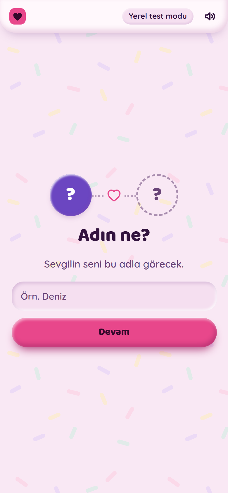
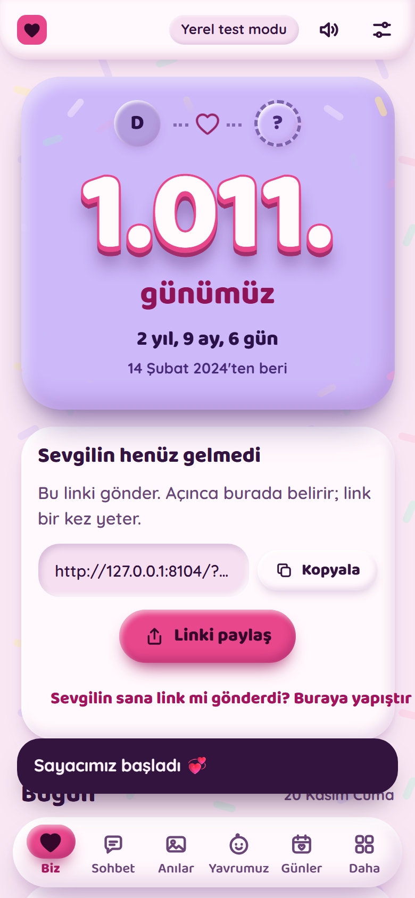
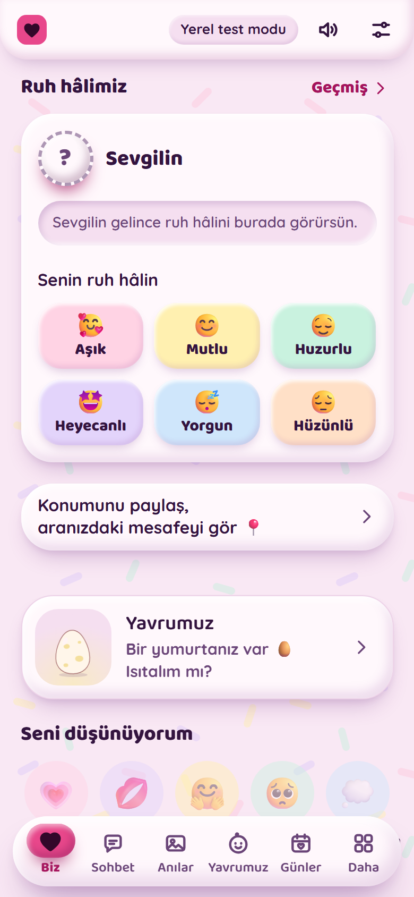
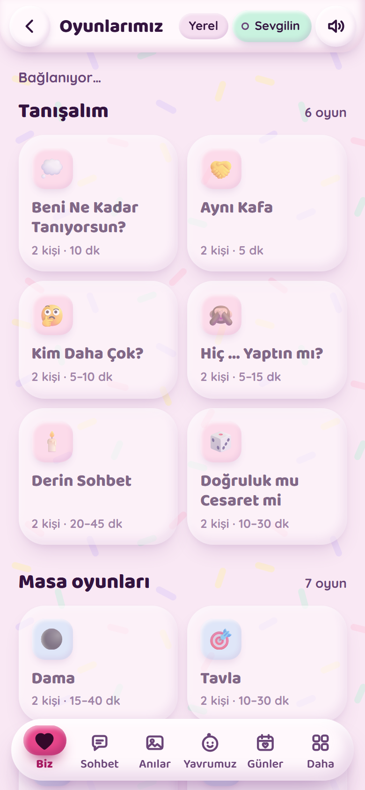
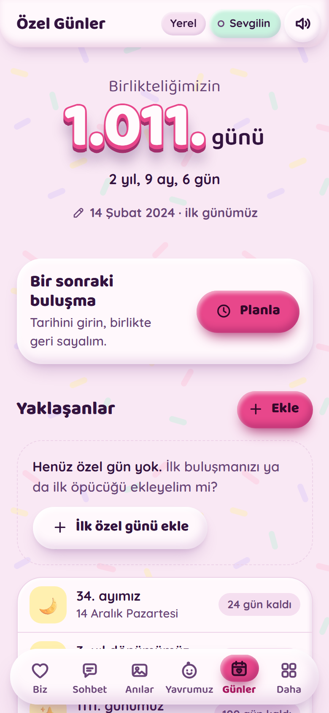
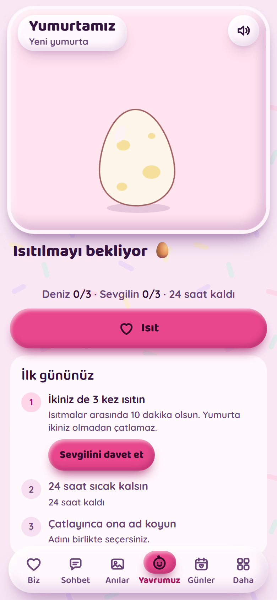
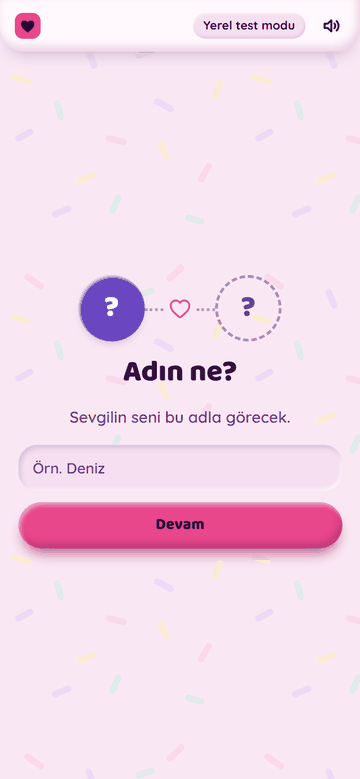

# Biz İkimiz

İki sevgilinin ücretsiz uygulaması. Statik site + Supabase (ücretsiz plan).
Adres: https://rose-omer.github.io/bizim-oyunlar/

## Özellikler
- **Biz:** kaç gündür birlikteyiz, yaklaşan özel günler, buluşma geri sayımı, dokunuş (kalp, öpücük, sarılma, özledim, düşünüyorum), ruh hâli, mesafe (isteğe bağlı).
- **Sohbet:** fotoğraf (WebP), sesli mesaj, tepki, yanıt, görüldü, yazıyor, arama, yıldızlı mesajlar.
- **Anılar:** fotoğraflı zaman çizelgesi, albüm, harita, "geçen yıl bugün". **Mektuplar:** zaman kapsülü.
- **Özel Günler:** takvim, doğum günleri, kilometre taşları, hatırlatma.
- **Listelerimiz** (Şarkılarımız dahil), **Randevu Fikirleri** (200 fikir), **Günün Sorusu** (432 soru, seri), **Sevgi Dili Testi**,
  **Birlikte İzle** (YouTube eş zamanlı), **Ruh Hâlimiz** (30/90 gün), **Günün Fotoğrafı**, **Haftalık Kontrol**, **Ortak Harcamalar**,
  **Yılımız** (yıl özeti), **Rozetlerimiz**, **Skor Tablosu**, **Aşk Kuponları**, **İzin Belgesi**, **Onun Hakkında**
  (ölçüler, sevdikleri, alerjiler), **Karar Çarkı**, **Not Bırak** (yazı, çizim, fotoğraf), **Konum** (canlı konum, mesafe),
  **Sohbet Özetimiz** (WhatsApp sohbeti dışa aktarımından özet).
- **Yavrumuz:** birlikte baktığınız sanal yavru; yumurtayı ikiniz ısıtırsınız, çatlayınca besler, oynar, yıkar, uyutursunuz; bakımla büyür.
- **Oyunlar (19):** Yapboz, Beni Ne Kadar Tanıyorsun, Aynı Kafa, Doğruluk mu Cesaret mi, Hafıza, Çiz Bakalım,
  Kim Daha Çok, Hiç Yaptın mı, Derin Sohbet, Dama, Tavla, Dört Taş, XOX, Amiral Battı, Satranç, Pişti, Kelime Zinciri, Kelime Düellosu, Birlikte Sudoku.
- **Güvenlik:** her cihaz odaya onayla girer (Ayarlar › Cihazlar); tek kullanımlık davet linki; kurtarma kodu.
- **Ayarlar:** profil, başlangıç tarihi, PIN kilidi, tema, bildirim, yedek indirme ve geri yükleme.
- **Güncelleme:** açık uygulama yeni yayını kendiliğinden alır. Android ana ekran widget'ı (gün sayacı).
- **Bildirim:** dokunuş, mesaj, mektup; her sabah 09:00 özel gün, akşam 20:00 günün sorusu hatırlatması.

## Ekran görüntüleri

| Giriş | Biz | Bugün |
|---|---|---|
|  |  |  |

| Oyunlar | Özel günler | Yavrumuz |
|---|---|---|
|  |  |  |

## Kullanım



1. Adınızı yazın, **Devam** deyin.
2. **Odamızı kur** ile odayı açın. Linki sevgilinize gönderin; o **Odaya katıl** ile girer.
3. Başlangıç tarihini girin; gün sayacı başlar.
4. **Bugün** bölümünde ruh hâlinizi seçin, **Seni düşünüyorum** ile dokunuş gönderin.
5. **Ne oynayalım?** altından oyun seçin; **Tüm oyunlar** 19 oyunu listeler.

Görseller yerel test kipiyle alındı (`?yerel=1`, Supabase'siz).

## Telefona kurma
- İndirme sayfası (Android ve iPhone yan yana): https://rose-omer.github.io/bizim-oyunlar/indir/
- **iPhone:** Safari → Paylaş → **Ana Ekrana Ekle**. Bildirim yalnız böyle kurulunca çalışır (iOS 16.4+).
- **Android:** Chrome → menü → **Uygulamayı yükle**. Ya da APK:
  https://rose-omer.github.io/bizim-oyunlar/indir/BizIkimiz.apk
  (APK partner bildirimini FCM ile alır; bkz. **Android anlık bildirim (FCM)**. Derleme FCM'siz olursa yalnız cihaz hatırlatıcıları çalışır.)

## Yerel çalıştırma
```bash
node dev/serve.mjs
```
- Aç: http://localhost:5173/?yerel=1 (`?yerel=1` = Supabase'siz; aynı tarayıcının iki sekmesi birbirini görür).

## Testler
```bash
npm test
```

## Supabase kurulumu
1. **SQL Editor** → `supabase/schema.sql` tamamı → **Run** (tekrar çalıştırmak güvenli).
2. **SQL Editor** → `C:/Users/koseo/.bizim-ikimiz/vault.sql` (gizli; depoda yok) → **Run** (bir kez).
3. Edge Function'lar ve gizli değerler:
   ```bash
   npx supabase login
   npx supabase secrets set --env-file C:/Users/koseo/.bizim-ikimiz/secrets.env --project-ref blgtlflryxknyalutugw
   npx supabase functions deploy bildir hatirlat --no-verify-jwt --use-api --project-ref blgtlflryxknyalutugw
   ```
4. Kontrol: `select jobname, schedule from cron.job;` → 2 satır.
- **Medya geçişi:** `supabase/gecis/` (kova kapatma, temizlik zamanlaması, adres taşıma). `schema.sql` bunları yapmaz; her biri ayrı onay ister. Function: `npx supabase functions deploy medya --no-verify-jwt --use-api --project-ref blgtlflryxknyalutugw`.
- **Yayın sırası** (şema değişince): (1) `schema.sql` tamamı, (2) `functions deploy`, (3) `git push`. Sıra bozulursa istemci
  "eski sunucu" moduna düşer, bozulmaz. Eski odalarda cihaz onayı (koruma) ilk girişten 3 gün sonra kendiliğinden başlar.
- `js/config.js`'teki publishable anahtar ve VAPID genel anahtarı gizli değildir. Özel anahtarlar yalnız
  `C:/Users/koseo/.bizim-ikimiz/` klasöründe (yedekle). "service_role" / "secret" anahtarını siteye koyma.

## Yayın
- Depo gizli; site herkese açık (GitHub Pro). Pages kaynağı: **GitHub Actions** (`build_type=workflow`).
- **GitHub Pages:** `.github/workflows/pages.yml` yayınlar: her `git push` (main), elle (`gh workflow run pages.yml`)
  ve Android APK işi başarıyla bitince. Yayın 1–2 dk sürer. `mobil/`, `supabase/`, `tests/`, `dev/` yayına girmez.
  `.nojekyll` silinmemeli (branch yayınına geri dönüşte gerekir).
- **Android APK:** `.github/workflows/android.yml`. `mobil/**` değişince ya da elle (`gh workflow run android.yml`) derlenir;
  `android-latest` sürümüne yüklenir (`BizIkimiz.apk`, `surum.json`). Gizli depoda Releases girişsiz indirilemez;
  `pages.yml` ikisini siteye koyar: `indir/BizIkimiz.apk` (indirme adresi), `indir/surum.json` (uygulamanın sürüm denetimi).
  İmza: `ANDROID_KEYSTORE_B64`, `ANDROID_KEYSTORE_PASSWORD`, `ANDROID_KEY_ALIAS`,
  `ANDROID_KEY_PASSWORD` secret'ları; anahtar `C:/Users/koseo/.bizim-ikimiz/android-keystore.p12` (kaybolursa güncelleme kurulmaz).

## Android anlık bildirim (FCM)
APK'nın WebView'ı Web Push desteklemez; APK partner bildirimini Firebase Cloud Messaging ile alır. Web/PWA Web Push ile kalır.
1. Firebase konsolu → proje → Android uygulaması ekle, paket adı `com.rose.bizikimiz` → `google-services.json` indir.
2. Proje ayarları → Hizmet hesapları → **Yeni özel anahtar oluştur** → JSON (gizli; depoya koyma).
3. GitHub secret `GOOGLE_SERVICES_JSON_B64` = `google-services.json` dosyasının base64 hâli. Yoksa APK FCM'siz derlenir (uyarıyla).
4. Supabase secret `FCM_SERVICE_ACCOUNT` = hizmet hesabı JSON'unun tam metni:
   `npx supabase secrets set --env-file <dosya> --project-ref blgtlflryxknyalutugw` (dosyada `FCM_SERVICE_ACCOUNT='<tek satır JSON>'`).
   Yoksa Edge Function'lar FCM'yi atlar, Web Push sürer.
5. `supabase/schema.sql` (8. bölüm: `fcm_sub`, `fcm_kaydet`, `fcm_sil`, ...) → SQL Editor → Run. Sonra `bildir` ve `hatirlat` yeniden dağıtılır.
6. Telefonda yeni APK (sürüm 1.2.x) → Ayarlar → **Anlık bildirimler** açık → izin ver.
- Uygulama açıkken gelen bildirim sistemde gösterilmez; sayfaya `bizim:bildirim` olayı gelir. Bildirime dokununca ilgili sayfa açılır.

## Uyanık tutma
- Ücretsiz Supabase 7 gün hareketsiz kalırsa durur.
- pg_cron hatırlatma işleri her gün çalışır; `keepalive.yml` 3 günde bir `ping` atar ve 45 günde bir boş commit ile
  GitHub'ın 60 gün kuralını önler.

## Ücretsiz plan sınırları
- Realtime: 200 eşzamanlı bağlantı, ayda 2 milyon mesaj. Depolama: 1 GB (fotoğraf ~0,5 MB). Veritabanı: 500 MB.
- Çıkış trafiği: ayda 5 GB. Edge Function: ayda 500 bin çağrı.

## Klasörler
- `index.html`, `js/hub.js`: Biz (ana sayfa). `sayfalar/<ad>/`: özellik sayfaları. `games/<oyun>/`: oyunlar.
- `js/core/`: oda, veri (`veri.js`), profil, tarih (`gunler.js`), arayüz, kilit, bildirim, PWA, mobil.
- `supabase/`: şema ve Edge Function'lar. `mobil/`: Capacitor Android. `sw.js`, `manifest.webmanifest`: PWA.
- `SOZLESME.md`: modüller arası sözleşme (geliştirici için).
